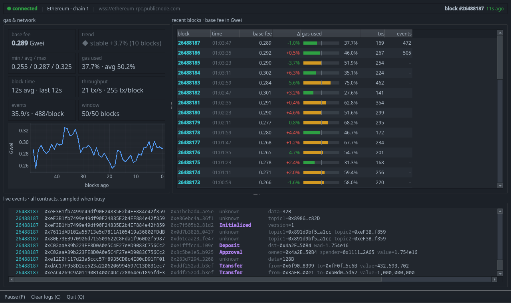

# gas_monitor

A real-time Ethereum block, gas price and event monitor for the terminal. It streams
`newHeads` and `logs` over a raw JSON-RPC WebSocket (no polling) and shows them in a
[Textual](https://textual.textualize.io/) UI, or in a desktop window with `--gui` (see
[Desktop GUI](#desktop-gui)). It works with any EVM chain whose node supports
`eth_subscribe`, such as Ethereum mainnet, Base or Arbitrum.

```
 ● connected  │  Ethereum · chain 1  │  wss://ethereum-rpc.publicnode.com                                        block #26463021  0.49s ago
╭─ gas & network ──────────────────────────────────────────╮╭─ recent blocks ──────────────────────────────────────────────────────────────╮
│ base fee     0.125 Gwei                                  ││ block      time        base fee        Δ  gas used             txs  events   │
│ trend        ◆ stable +2.1% (10 blocks)                  ││ 26463021   12:56:11       0.125    +4.1%  █████░░░░░  49.7%      …      39   │
│ min/avg/max  0.114 / 0.141 / 0.167                       ││ 26463020   12:55:59       0.120    -3.5%  ███████░░░  66.3%    245   2,221   │
│ gas used     49.7% · avg 49.1%                           ││ 26463019   12:55:47       0.124    -2.8%  ████░░░░░░  36.2%    165     594   │
│ block time   12s avg · last 12s                          ││ 26463018   12:55:35       0.128   +12.5%  ████░░░░░░  39.0%    267       –   │
│ throughput   19 tx/s · 232 tx/block                      ││ 26463017   12:55:23       0.114    -3.7%  ██████████  99.9%    166       –   │
│ events       95.6/s · 951/block                          ││ 26463016   12:55:11       0.118    -2.2%  ████░░░░░░  35.2%    204       –   │
│ window       50/50 blocks                                ││ 26463015   12:54:59       0.121    -4.3%  ████░░░░░░  41.0%    255       –   │
│ ▃▃▁ ▁▁▃▄    ▇▆▆▃▂█▆▆▄ ▄▁ ▃▄▄▄▃██▆▂▃                      ││ 26463014   12:54:47       0.126    +8.7%  ███░░░░░░░  33.0%    182       –   │
│ ███▇████▁  ▄████████████▇████████████▃▃  ▄▂              ││ 26463013   12:54:35       0.116    -6.2%  ████████░░  84.8%    313       –   │
│ █████████▁▁████████████████████████████▆███▄▃    ▂   ▃   ││ 26463012   12:54:23       0.124    +0.3%  ███░░░░░░░  25.1%    139       –   │
╰─────────────────────────────────────── base fee history ─╯╰─────────────────────────────────────────────────────────── base fee in Gwei ─╯
╭─ live events ────────────────────────────────────────────────────────────────────────────────────────────────────────────────────────────╮
│  26463020  0xA0b86991c6218b36c1d19D4a2e9Eb0cE3606eB48  0xddf252ad…b3ef  Transfer         from=0xE055…939F to=0xEff6…A167 value=1,537,1…  │
│            ⋯ 29 more events not shown                                                                                                    │
│  26463021  0xC02aaA39b223FE8D0A0e5C4F27eAD9083C756Cc2  0xddf252ad…b3ef  Transfer         from=0xE416…c82F to=0xc7bB…0e9b value=2.658e17  │
│  26463021  0x000000000004444c5dc75cB358380D2e3dE08A90  0x40e9cecb…112f  Swap             id=0x912b338a…9375 sender=0xE416…c82F amount0…  │
│  26463021  0xC02aaA39b223FE8D0A0e5C4F27eAD9083C756Cc2  0x7fcf532c…1b65  Withdrawal       src=0xE416…c82F wad=4.589e17                    │
╰─────────────────────────────────────────────────────────────────────────────────────────────────────── all contracts, sampled when busy ─╯
 q quit  p pause/resume  c clear logs
```

## Setup

Requires Python 3.10+.

```bash
python -m venv .venv
source .venv/bin/activate
pip install -r requirements.txt
cp .env.example .env   # then set WS_RPC_URL (the default is a free public endpoint)
python main.py
```

For the desktop GUI, install `requirements-gui.txt` instead (it includes
`requirements.txt`), see [Desktop GUI](#desktop-gui).

## Usage

```bash
python main.py                                    # settings from .env
python main.py -u wss://base-rpc.publicnode.com   # override the endpoint
python main.py -c 0xA0b86991c6218b36c1d19D4a2e9Eb0cE3606eB48   # only USDC events
python main.py --no-logs -w 100                   # blocks only, 100-block window
```

| Environment variable | Flag | Default | Description |
| --- | --- | --- | --- |
| `WS_RPC_URL` | `-u`, `--rpc-url` | (required) | WebSocket endpoint (`ws://` or `wss://`) |
| `CONTRACT_ADDRESS` | `-c`, `--contract` | all contracts | Contract(s) to stream logs from, comma-separated |
| `WINDOW_SIZE` | `-w`, `--window` | `50` | Rolling window in blocks (2–1000) |
| `SUBSCRIBE_LOGS` | `--logs` / `--no-logs` | `true` | Subscribe to logs at all |
| `STALE_TIMEOUT` | `--stale-timeout` | `60` | Reconnect after this many seconds without a block (`0` disables) |
| `LOG_FILE` | `--log-file` | none | Write connection diagnostics to a file |
| `GUI` | `--gui` / `--no-gui` | `false` | Open the desktop GUI instead of the terminal UI |
| | `--env-file` | `./.env` | Read variables from another file |

Precedence is CLI flag, then environment variable, then `.env`. Mixed-case contract
addresses are validated against their EIP-55 checksum to catch typos.

### Keys

| Key | Action |
| --- | --- |
| `q` | Quit |
| `p` | Pause / resume panel updates (data keeps being collected in the background) |
| `c` | Clear the event feed |

Scroll the blocks table to inspect older rows; it stops updating while scrolled and
resumes when you scroll back to the top.

## Desktop GUI



```bash
python main.py --gui                                   # same flags and .env as the TUI
python main.py --gui -u wss://base-rpc.publicnode.com
```

The GUI shows the same panels and colors as the terminal UI, built with
[PySide6](https://doc.qt.io/qtforpython-6/) (Qt), [pyqtgraph](https://www.pyqtgraph.org/)
for the base fee chart and [qasync](https://github.com/CabbageDevelopment/qasync), which
runs the WebSocket client inside the Qt event loop on a single thread. Its packages take
about 250 MB and the terminal UI does not need them, so they are in a separate file:

```bash
pip install -r requirements-gui.txt   # TUI requirements + PySide6, pyqtgraph, qasync
```

- **Keys:** `P` pause / resume, `C` clear the event feed, `Q` or `Ctrl+Q` quit; the same
  actions are on the toolbar at the bottom. While paused the window frame turns yellow.
- **Blocks table:** new blocks are added at the top without moving the rows you are
  reading, so you can scroll down and keep reading while it updates.
- **Event feed:** follows the newest events while it is scrolled to the bottom, and stays
  put when you scroll up. It keeps the last 250 lines.
- **Layout:** drag the splitters between the panels. The window size and splitter
  positions are restored on the next start (on Linux from `~/.config/gas_monitor/gui.conf`).
- **Wayland:** if the window does not open, try `QT_QPA_PLATFORM=xcb python main.py --gui`.

## Tests

```bash
python -m unittest
```

The tests cover the shared formatting helpers, the GUI blocks table (model and scroll
position) and the base fee chart. The GUI tests are skipped when the GUI packages are not
installed.

## How it works

- **Connection.** `ws_client.py` speaks JSON-RPC directly over `websockets`. One reader
  task dispatches both request responses and subscription notifications. On disconnect
  it reconnects with exponential backoff and jitter (1 s doubling up to 30 s). The backoff
  only resets after a session has actually delivered a block. If the connection stays
  open but no block arrives for `STALE_TIMEOUT` seconds, it reconnects too. API keys in
  the URL are never displayed; only the host is shown.
- **Data.** `newHeads` has no transactions, so each block's tx count is fetched with
  `eth_getBlockTransactionCountByHash`. After connecting, the window is backfilled with
  `eth_getBlockByNumber`, so stats are available immediately. After a reconnect only the
  missed blocks are fetched, and so are any heads the provider skipped.
- **Metrics** (`metrics.py`), over the rolling window:
  - base fee in Gwei, with min / avg / max;
  - trend: a least-squares fit over the last 10 blocks, labelled rising or falling above
    ±0.5% per block;
  - utilization: `gasUsed / gasLimit`;
  - block time: from timestamps over block-number spans, so gaps don't skew it;
  - event rate: events per second over the last minute.
- **Events** (`decoder.py`). topic0 is matched against a built-in table of common
  signatures (ERC-20/721/1155, WETH, Uniswap V2/V3/V4, Permit2, Curve, Balancer, Aave,
  Chainlink, OpenZeppelin). Indexed and static data parameters are decoded. Addresses are
  shown with EIP-55 checksums. Keccak-256 comes from OpenSSL 3.2+ when available, with a
  pure-Python fallback, so there are no extra dependencies.
- **Busy chains.** Without a contract filter, chains like Base emit hundreds of logs per
  second. All of them are counted, but the feed shows only the newest few per refresh
  and summarizes the rest. Some providers deliver logs a few seconds after the block
  header; those blocks show `…` in the events column until their logs arrive. Expect
  roughly 5–10% of one CPU core on Ethereum mainnet and around 25% on 200 ms-block
  chains without a filter. Use `CONTRACT_ADDRESS` to focus on one contract and cut the
  load considerably.

In the blocks table, `…` means data is still on its way. `–` in the events column means
the logs subscription did not cover that block (for example, backfilled history).

## Project layout

| File | Role |
| --- | --- |
| `main.py` | Entry point: wires configuration, metrics, client and UI together |
| `config.py` | `.env` / environment / CLI configuration and validation |
| `ws_client.py` | Async JSON-RPC WebSocket client, subscriptions, reconnection |
| `metrics.py` | Rolling window and derived statistics |
| `decoder.py` | Keccak-256, EIP-55 addresses, event signature table and log decoding |
| `formatting.py` | Display formatting shared by both UIs (numbers, colors, feed lines) |
| `tui.py` | Textual app: status bar, gas panel, blocks table, event feed |
| `gui/` | PySide6 desktop GUI: `app.py` (qasync loop), `main_window.py`, one module per panel, `theme.py` |
| `tests/` | Unit tests (`python -m unittest`) |
| `requirements.txt` | Terminal UI dependencies |
| `requirements-gui.txt` | Desktop GUI dependencies (includes `requirements.txt`) |
